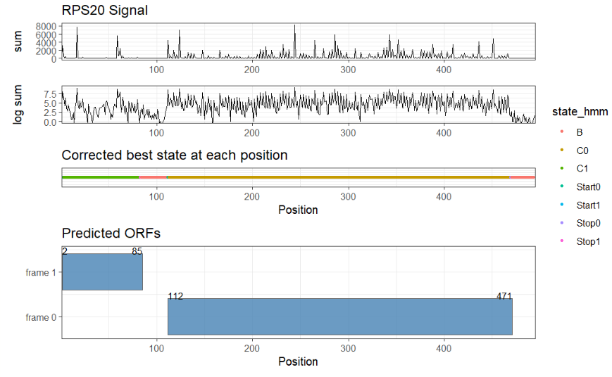
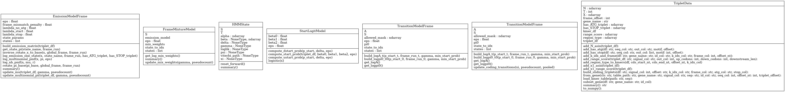
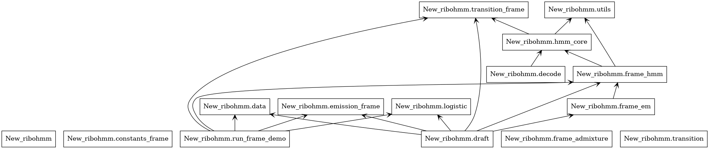

# Unified-frame RiboHMM Code Overview 

## 1. What this codebase does

This codebase is used to detect ORFs from the **ribosome signal of a single gene (k-mer / triplet signal)**. This version adopts a **unified-frame HMM**:

- all candidate coding states are explicitly split into **three global frame-specific state chains**;
- triplets generated from `frame_run = 0, 1, 2` are concatenated into one unified large triplet dataframe;
- HMM inference is then performed on this unified sequence under a dynamic start-probability mechanism.

The hidden states in the current unified-frame HMM are:

- `B`
- `Start0, C0, Stop0`
- `Start1, C1, Stop1`
- `Start2, C2, Stop2`

Here:

- `B` denotes background;
- `Startg -> Cg -> Stopg` denotes one coding chain on global frame `g`;
- `frame_run` is **not** a hidden state. It is an observed attribute of each triplet row and is used to determine which global frame the current row should align with.

This README is based on the **latest `run_frame_demo.py` in the current directory**.

**input**: Kmer counts table  
**outputs**:
- Triplet imformation
- Predicted ORFs
- Plots:


---

## 2. Actual main entry point used in the current version

The actual main entry point is:

```bash
python run_frame_demo.py
```

Its main outputs are:

- `df_fit_hmm.txt`: final HMM results for each triplet;
- `candidate_orfs.txt`: candidate ORFs extracted from the final Viterbi path.

---

## 3. Which files to read first

If this is your first time reading this codebase, the recommended order is:

1. `run_frame_demo.py`: the current unified-frame main entry.
2. `constants_frame.py`: state definitions, initial parameters, and initial transition skeleton.
3. `data.py`: how raw k-mer data are converted into one unified large triplet dataframe.
4. `emission_frame.py`: how unified-frame emission probabilities are defined.
5. `logistic.py`: how the start probability is computed for each triplet.
6. `transition_frame.py`: how dynamic transitions are rewritten based on `p_start` and `frame_run`.
7. `frame_hmm.py`: forward / backward / gamma / xi / Viterbi decoding.
8. `frame_em.py`: the HMM-EM main loop, plus the optional non-HMM mixture EM.
9. `seg_signal_plot.R`: downstream visualization script for the outputs of this pipeline.

Some of the remaining files belong to:

- legacy logic retained from earlier versions;
- duplicated files;
- auxiliary debugging scripts;
- experimental files not called by the current main workflow.

These will be described separately below.

---

## 4. Actual execution order of the current main workflow

### Step 0. Program entry: `run_frame_demo.py`

`run_frame_demo.py` is the script that connects the current unified-frame workflow. Its main procedure is:

1. read the raw k-mer-level table;
2. select the target gene;
3. build sliding triplets separately for `frame_run = 0, 1, 2`;
4. merge the triplets from the three `frame_run` settings into one unified large dataframe;
5. initialize the unified-frame emission model;
6. compute the start probability `p_start` for each triplet;
7. initialize the unified-frame transition model;
8. run `run_hmm_em_frame()` to perform HMM-EM;
9. assign a final state to each triplet using the final Viterbi path;
10. extract candidate ORFs from the path;
11. write out `df_fit_hmm.txt` and `candidate_orfs.txt`.

---

### Step 1. Read the raw k-mer table and subset the target gene: `data.py`

In `run_frame_demo.py`, the first calls are:

- `TripletData.load_kmer_table(...)`
- `TripletData.subset_gene(...)`

Their roles are:

- read `KmersFromContigsQuerySum`;
- keep only the rows corresponding to one target gene (`GENE_NAME`);
- restrict downstream analysis to a single gene.

At this stage, no HMM is involved yet. This is only input preparation.

---

### Step 2. Add frame and motif annotations to k-mers: `data.py`

Next, `run_frame_demo.py` calls:

- `TripletData.add_k_idx_and_frame(...)`
- `TripletData.add_has_atg(...)`
- `TripletData.add_has_stop(...)`

Among them:

#### 2.1 `add_k_idx_and_frame(...)`

This function:

- extracts the `k_idx` of each k-mer from the `id` field;
- computes its transcript frame according to `OFFSET`.

#### 2.2 `add_has_atg(...)`

This function detects whether each k-mer contains `ATG` at the specified offset position.

#### 2.3 `add_has_stop(...)`

This function detects whether each k-mer contains a stop codon at the specified offset position:

- `TAA`
- `TGA`
- `TAG`

These annotations will later enter the emission scoring.

---

### Step 3. Build the unified large triplet dataframe: `data.py`

`run_frame_demo.py` no longer follows the older strategy of “run a full HMM separately for each frame and then merge the results”. Instead, it:

- calls `TripletData.build_sliding_triplets(df_kmer, offset=frame)` separately for `frame_run = 0, 1, 2`;
- generates one set of triplet-level observations each time;
- concatenates all three sets together;
- sorts by `start_kidx` to form one unified large triplet dataframe: `df_triplet_fit`.

Each triplet observation contains:

- `x1, x2, x3`: signal at the three positions of the triplet;
- `N = x1 + x2 + x3`;
- `start_kidx / mid_kidx / end_kidx`;
- `has_ATG_triplet`;
- `has_STOP_triplet`;
- and later-added columns such as `frame_run`, `x1_range_score`, and `x1_asin`.

In other words, the current model considers all three frames **simultaneously on one unified sequence**.

---

### Step 4. Build logistic features: `data.py`

For the triplets generated under each `frame_run`, the code also calls:

- `TripletData.add_x1_range_score(...)`
- `TripletData.add_x1_asin(...)`

These two features are then used by `logistic.py` to compute the dynamic `p_start` for each triplet.

The features actually used in the current version are:

- `x1_asin`
- `x1_range_score`

rather than the older `N_asin + range_score` combination often mentioned in previous documentation.

---

### Step 5. Initialize unified-frame HMM parameters: `constants_frame.py`

`constants_frame.py` defines the core structure of this version.

#### 5.1 State set

```text
B
Start0, C0, Stop0
Start1, C1, Stop1
Start2, C2, Stop2
```

#### 5.2 Initial emission parameters

Each state defines:

- `mu`
- `r`
- `pi` or `pi_base`
- `type`
- and for coding-related states, `global_frame`

Here:

- `B` directly uses its own background multinomial distribution `pi`;
- `Startg / Cg / Stopg` use a canonical `pi_base`, which will later be rotated according to `frame_run`.

#### 5.3 Initial transition skeleton

The initial skeleton is:

- `B -> B or Start0/1/2`
- `Startg -> Cg`
- `Cg -> Cg or Stopg`
- `Stopg -> B`

Note that this is only a **static skeleton**. The true position-dependent start-opening logic is not implemented in `constants_frame.py`, but in `transition_frame.py`.

---

### Step 6. Initialize the emission model: `emission_frame.py`

`run_frame_demo.py` initializes the unified-frame emission model with `EmissionModelFrame(...)`.

The main ideas of the current emission model are:

1. for each triplet, the total signal `N` is modeled by a Negative Binomial distribution;
2. the within-triplet composition `(x1, x2, x3)` is modeled by a Multinomial distribution;
3. the canonical `pi_base` of `Startg / Cg / Stopg` is rotated according to
   `local_frame = (global_frame - frame_run) % 3`;
4. if the `frame_run` of a given triplet row does not match the `global_frame` of `Startg / Stopg`, a strong negative penalty is applied;
5. for `start` states, a bonus or penalty is applied depending on `has_ATG_triplet`;
6. for `stop` states, a bonus is applied depending on `has_STOP_triplet`.

Therefore, this version does not hard-code frame information into three separate models. Instead, it links global frame and local `frame_run` **within a single emission model through rotation and penalty mechanisms**.

---

### Step 7. Optional non-HMM pretraining: `frame_em.py`

`frame_em.py` defines `run_frame_em(...)`, which corresponds to:

- a non-HMM mixture EM;
- independent posterior classification of each triplet;
- no transition structure between neighboring triplets.

Its states are still the unified-frame 10 states, but mathematically it is a mixture model, not an HMM.

#### Is this part enabled in the current main script?

**In the latest `run_frame_demo.py`, this entire block is commented out.**

That means:

- the code still retains the design of “first run a non-HMM EM pretraining, then run HMM-EM”;
- but in the current actual execution, the program **skips this pretraining step**.

Therefore, the comment in the main script:

```python
emission_model=emission_model,      # already pre-trained by mixture EM
```

is actually an **outdated comment** in the current version. At present, `emission_model` is not pre-trained by `run_frame_em()` unless you manually restore that commented block.

In practice, whether or not this pretraining is used does not strongly affect the final result, so it is currently disabled.

---

### Step 8. Compute the dynamic start probability: `logistic.py`

`run_frame_demo.py` then calls:

```python
p_start = StartLogitModel.compute_start_prob(...)
```

The features used here are:

- `x1_asin`
- `x1_range_score`

with the formula:

```text
p_start[t] = sigmoid(beta0 + beta1 * x1_asin[t] + beta2 * x1_range_score[t])
```

`compute_ustart_prob()` and `compute_dstart_prob()` still exist, but they belong to the older region-based logic. The current unified-frame main workflow only uses `p_start` directly.

---

### Step 9. Initialize the dynamic transition model: `transition_frame.py`

`run_frame_demo.py` then initializes the unified-frame transition model with `TransitionModelFrame(...)`.

The key points of this file are:

#### 9.1 Initial distribution `build_logpi0_t0(...)`

At the first triplet of the sequence, only the following are allowed:

- `B`
- `Start{frame_run[0]}`

That is, at the initial position, the start entry is only open for the frame corresponding to the current row.

#### 9.2 Dynamic transition `build_logA_t(...)`

At any position `t`, not all `B -> Start0/1/2` transitions are allowed.

The current logic is:

- only `B -> Start{frame_run[t]}` is allowed;
- all other `B -> Startg` transitions are forced to zero;
- `B -> B` and `B -> Start{frame_run[t]}` are then renormalized jointly.

Therefore, `p_start[t]` determines whether:

- the current triplet is allowed to jump from background into the coding chain whose global frame matches the current row’s `frame_run`.

#### 9.3 Transition update `update_coding_transitions(...)`

In the M-step of HMM-EM, the current code updates only:

- `C0 -> C0 / Stop0`
- `C1 -> C1 / Stop1`
- `C2 -> C2 / Stop2`

and allows two options:

- `pooled=True`: pool the coding transitions across the three frames when estimating them;
- `pooled=False`: estimate each frame separately.

The current main script uses `pooled_transition=True`.

---

### Step 10. HMM-EM main loop: `frame_em.py` + `frame_hmm.py`

The actual HMM learning is handled by `run_hmm_em_frame(...)`.

Its execution order is:

#### 10.1 E-step

First compute the emission matrix, then call:

- `forward_log_dynamic_frame(...)`
- `backward_log_dynamic_frame(...)`
- `compute_gamma_frame(...)`
- `compute_xi_dynamic_frame(...)`

These functions are all defined in `frame_hmm.py`.

#### 10.2 M-step

Then update:

- `emission_model.update_mu(...)`
- `emission_model.update_multinomial_pi(...)`
- `transition_model.update_coding_transitions(...)`

Here:

- `mu` is the Negative Binomial mean;
- `pi_base` is the canonical multinomial template for Start / Coding / Stop;
- the coding transition update is restricted to the `Cg -> Cg / Stopg` part.

#### 10.3 Convergence check

If the change in log-likelihood between two consecutive iterations is smaller than `tol`, the loop stops early.

#### 10.4 Final decoding

After EM ends, `run_hmm_em_frame(...)` runs one more round with the final parameters:

- `viterbi_decode_dynamic_frame(...)`
- `forward_log_dynamic_frame(...)`
- `backward_log_dynamic_frame(...)`
- `compute_gamma_frame(...)`
- `compute_xi_dynamic_frame(...)`

So the returned `hmm_state` contains at the same time:

- the final Viterbi path;
- the final gamma;
- the final xi;
- the final delta / psi;
- the final log-likelihood trace.

---

### Step 11. Write results back to the dataframe: `run_frame_demo.py`

The main script then writes the final results back into the dataframe:

- `df_fit_hmm["p_start"]`
- `df_fit_hmm["state_hmm"]`
- `df_fit_hmm["gamma_<state>"]`

The current latest script writes the posterior as **one column for each fine-grained state**, for example:

- `gamma_B`
- `gamma_Start0`
- `gamma_C0`
- `gamma_Stop0`
- ...

But it no longer writes older aggregated columns such as `gamma_F0 / gamma_F1 / gamma_F2`.

The final dataframe is written to:

```text
{OUTPUT_DIR}/df_fit_hmm.txt
```

---

### Step 12. Extract candidate ORFs from the final Viterbi path: `run_frame_demo.py`

Unlike the previous version, `extra_orfs_from_viterbi(...)` is defined directly inside `run_frame_demo.py` rather than in a separate `extra_ORF.py` file.

The current extraction logic only recognizes three types of chains:

- `Start0 -> C0 ... -> Stop0`
- `Start1 -> C1 ... -> Stop1`
- `Start2 -> C2 ... -> Stop2`

For each candidate ORF, it records:

- `frame`
- `triplet_start_idx`
- `triplet_end_idx`
- `k_start`
- `k_end`
- `n_triplets`
- `orf_score`
- `mean_orf_score`
- `has_atg`
- `has_stop`

The final ORF table is written to:

```text
{OUTPUT_DIR}/candidate_orfs.txt
```

---

## 5. Files that are actually used in the current version

The following files belong to the current unified-frame main workflow.

### 5.1 Main entry

#### `run_frame_demo.py`

Current unified-frame main script.

Responsible for:

- reading data;
- building triplets;
- computing start probabilities;
- HMM-EM training;
- writing results;
- extracting candidate ORFs.

---

### 5.2 Parameter file

#### `constants_frame.py`

The parameter file actually used by the current unified-frame version.

It includes:

- `DATA_DIR`, `OUTPUT_DIR`, `GENE_NAME`, `OFFSET`
- `LAMBDA_START`, `LAMBDA_STOP`, `LAMBDA_NO_ATG`
- `BETA0`, `BETA1`, `BETA2`
- `STATE_NAMES`
- `STATE_PARAMS`
- `A_INIT_HMM`
- `ALLOWED_MASK`
- `PI0_INIT_HMM`

---

### 5.3 Data preprocessing

#### `data.py`

Responsible for:

- reading the k-mer table;
- subsetting by gene;
- extracting `k_idx` and computing frame;
- adding `ATG/STOP` labels;
- building sliding triplets;
- adding `x1_asin` and `x1_range_score`.

This file also retains several functions related to FASTA / CDS coordinates, but these are not called in the current unified-frame main workflow.

---

### 5.4 Emission model

#### `emission_frame.py`

The current unified-frame emission model.

Responsible for:

- NB + multinomial emission scoring;
- frame rotation of `pi_base`;
- start/stop motif weighting;
- M-step updates of `mu` and `pi_base`.

---

### 5.5 Start probability

#### `logistic.py`

Responsible for computing `p_start` from triplet-level features.

The function actually used in the current unified-frame workflow is:

- `compute_start_prob()`

while `compute_ustart_prob()` and `compute_dstart_prob()` are more like retained interfaces from the older region-based logic.

---

### 5.6 Dynamic transition

#### `transition_frame.py`

The transition model actually used by the current unified-frame workflow.

Responsible for:

- maintaining `A` and `pi0`;
- dynamically rewriting the `B` row at each position using `p_start` and `frame_run`;
- updating coding transitions.

---

### 5.7 HMM core

#### `frame_hmm.py`

Responsible for the unified-frame implementation of:

- `forward_log_dynamic_frame`
- `backward_log_dynamic_frame`
- `compute_gamma_frame`
- `compute_xi_dynamic_frame`
- `viterbi_decode_dynamic_frame`

This is the HMM inference implementation that is actually called by the current main workflow.

---

### 5.8 EM / HMM-EM training

#### `frame_em.py`

This is the core training file for the unified-frame logic.

It contains two parts:

1. `run_frame_em(...)`
   - non-HMM mixture EM;
   - retained in the current main script but commented out by default;
2. `run_hmm_em_frame(...)`
   - the unified-frame HMM-EM actually used by the current main script.

---

### 5.9 Numerical utility

#### `utils.py`

Currently mainly provides:

- `logsumexp()`

which is used by `frame_hmm.py` and `hmm_core.py`.

---

### 5.10 State container

#### `hmm_core.py`

This file is **partially used** in the current unified-frame workflow:

- `HMMState` is directly reused by `frame_hmm.py`;
- however, the older functions such as `forward_log_dynamic / backward_log_dynamic / compute_xi_dynamic` are not called by the current unified-frame main chain.

So this file is not the main inference implementation for the current logic.

---

## 6. Files retained but not executed by default in the current version

### 6.1 `run_frame_em(...)` in `frame_em.py`

This is the non-HMM mixture EM pretraining logic.

- the code exists;
- by design, it can be used as emission-parameter pretraining;
- but in the latest `run_frame_demo.py`, this whole block is commented out.

### 6.2 `draft.py`

This is a lightweight debugging script.

It only:

- builds `df_triplet_fit`;
- prints `head()`.

It does not proceed to HMM-EM and does not produce final ORF outputs.

### 6.3 `frame_admixture.py`

This is another earlier / more independent idea:

- no HMM is used;
- each triplet is fitted independently to `B / F0 / F1 / F2`;
- local classification is performed through BIC/AIC and support values;
- the local frame is then corrected to a global frame according to `frame_run`.

It is useful for understanding the “frame mixture” idea, but it is **not called by the current unified-frame main workflow**.


## 7. Description of the current output files

### 7.1 `df_fit_hmm.txt`

Triplet-level result file produced by the current unified-frame main script.

It typically contains:

- raw triplet observations: `x1, x2, x3, N`
- positional indices: `start_kidx`, `mid_kidx`, `end_kidx`
- `frame_run`
- `p_start`
- final Viterbi state: `state_hmm`
- posterior for each state: `gamma_<state>`

This file is useful for:

- inspecting the decoded path;
- inspecting posterior probabilities;
- checking which frame-specific state chain is favored at each position.

### 7.2 `candidate_orfs.txt`

Candidate ORF file produced by the current unified-frame main script.

Its columns are closer to a summary of candidate coding segments, and usually include:

- `frame`
- `triplet_start_idx`
- `triplet_end_idx`
- `k_start`
- `k_end`
- `n_triplets`
- `orf_score`
- `mean_orf_score`
- `has_atg`
- `has_stop`

Note: in the current new script, the candidate ORF output **does not contain an `orf_type` field by default**.

---

## 9. How to interpret the R script

It visualizes the output results, including the sum signal, log sum signal, and the predicted frame 0 / 1 / 2 ORFs.

---

## 10. Code dependency graph (for the current main workflow)

The actual chain currently in use can be simplified as:

```text
run_frame_demo.py
  -> data.py
  -> constants_frame.py
  -> emission_frame.py
  -> logistic.py
  -> transition_frame.py
  -> frame_em.py (run_hmm_em_frame)
      -> frame_hmm.py
      -> emission_frame.py
      -> transition_frame.py
      -> hmm_core.py (HMMState)
      -> utils.py
  -> extra_orfs_from_viterbi inside run_frame_demo.py
```

---

## 11. If you want to actually run this version of the code

At minimum, you need to ensure that:

1. the paths in `constants_frame.py` are correct;
2. `GENE_NAME` is set to the gene you want to analyze;
3. `KmersFromContigsQuerySum` exists;
4. your Python environment has the following installed:
   - `numpy`
   - `pandas`
   - `scipy`

Run with:

```bash
python run_frame_demo.py
```

---

## 12. Code structure diagram
Class this script define:

Workflow:

